# Obsidian Disassembler

**A focused Windows reverse-engineering workspace for native PE binaries.**

Obsidian Disassembler combines PE inspection, hex inspection, x86/x64 disassembly, function discovery, control-flow and call graphs, project annotations, and safe instruction patching in one native Windows desktop application.

[](https://github.com/Stanfi1/OBSIDIAN-DISASSEMBLER/releases/latest)
[](LICENSE)
[](#downloads)
[](https://dotnet.microsoft.com/)

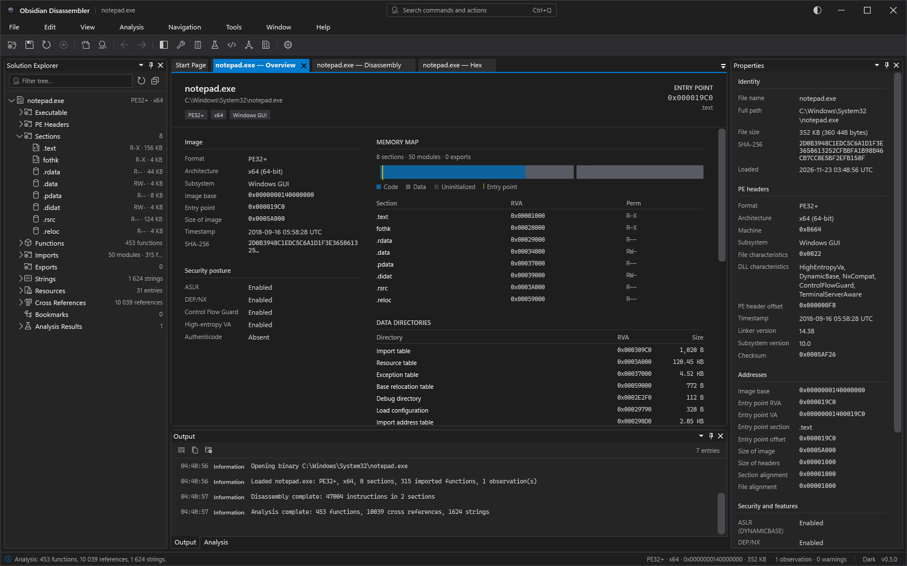

## Landing demo

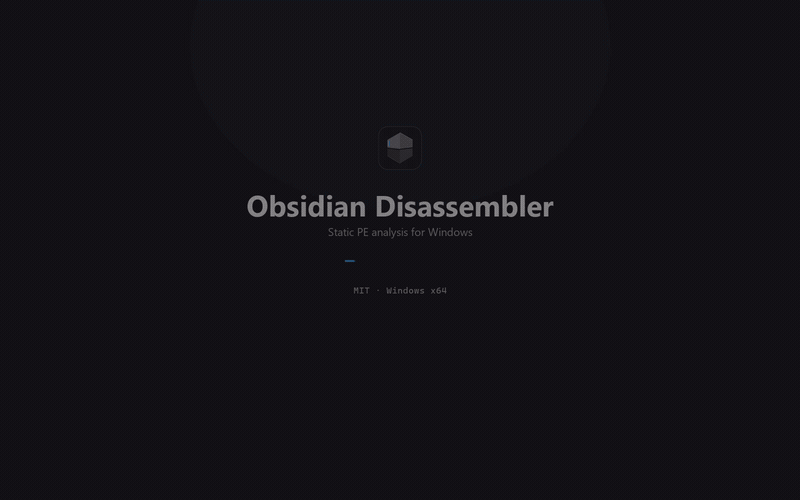

A higher-quality MP4 is attached to each [GitHub release](https://github.com/Stanfi1/OBSIDIAN-DISASSEMBLER/releases/latest).

## What it does

| Area | Capabilities |
| --- | --- |
| **PE inspection** | PE32/PE32+, headers, sections, data directories, imports, exports, resources, relocations, TLS, exceptions, debug entries, load configuration, structural findings |
| **Hex inspection** | Read-only virtualized hex/ASCII view, file offset/RVA/VA modes, inline search, multi-select and copy |
| **Disassembly** | Iced x86/x64 linear disassembly, Go To, follow branch, instruction inspection, 1,000,000-instruction cap with explicit truncation |
| **Analysis** | Seed-based function discovery, basic blocks, CFG edges, call graph, call/jump/conditional/data cross references, ASCII and UTF-16LE strings |
| **Graphs** | Interactive top-down control-flow graph with pan/zoom/fit, focused call-neighborhood graph, click-through navigation |
| **Projects** | SQLite `.obsproj` file with labels, comments, bookmarks, and persisted patch operations |
| **Patching** | Same-length instruction byte patches with Iced preview, validation, undo/redo, project replay, and save-copy |
| **Navigation** | Virtualized analysis browser, function/string/xref properties, bookmarks, Go To, back/forward history |

## Screenshots

| Control-flow graph | Call graph |
| --- | --- |
| 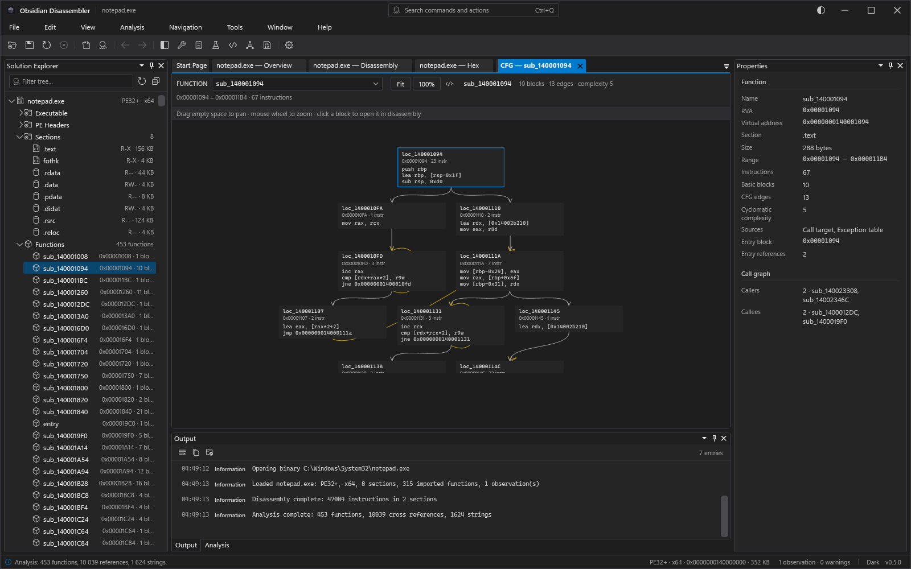 | 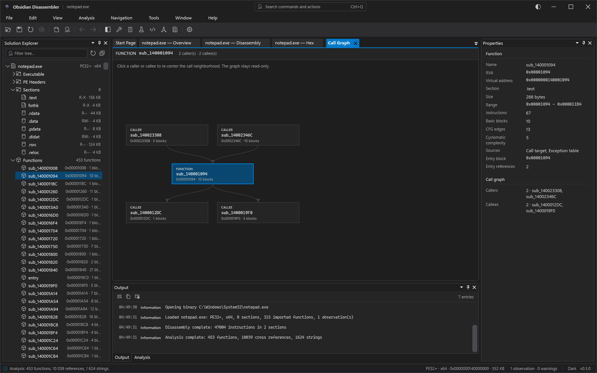 |

| Analysis browser | Project annotations |
| --- | --- |
| 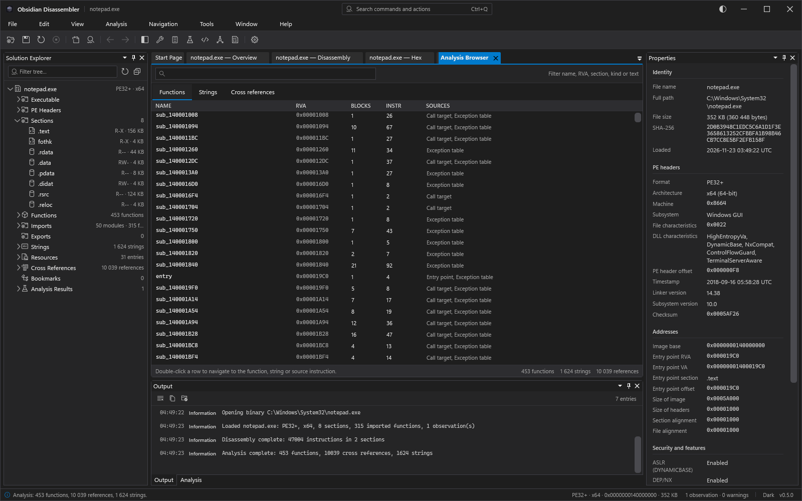 | 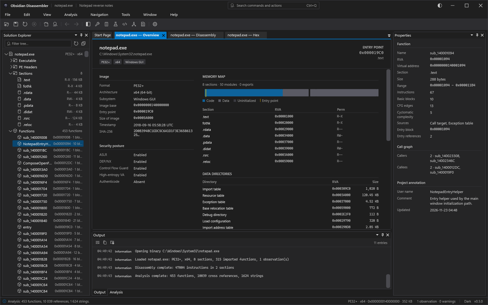 |

| Functions | Strings |
| --- | --- |
| 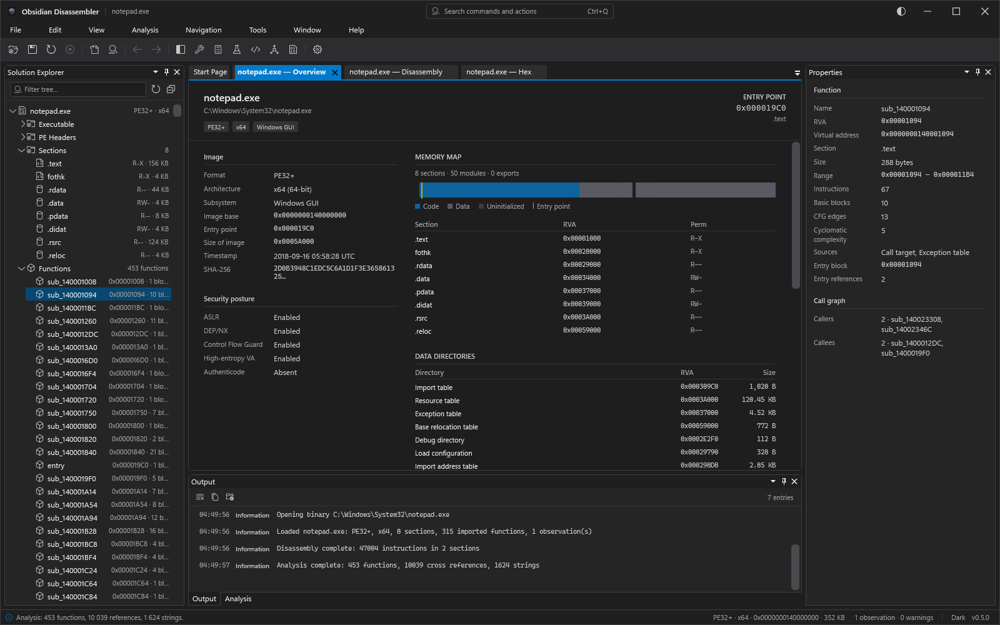 | 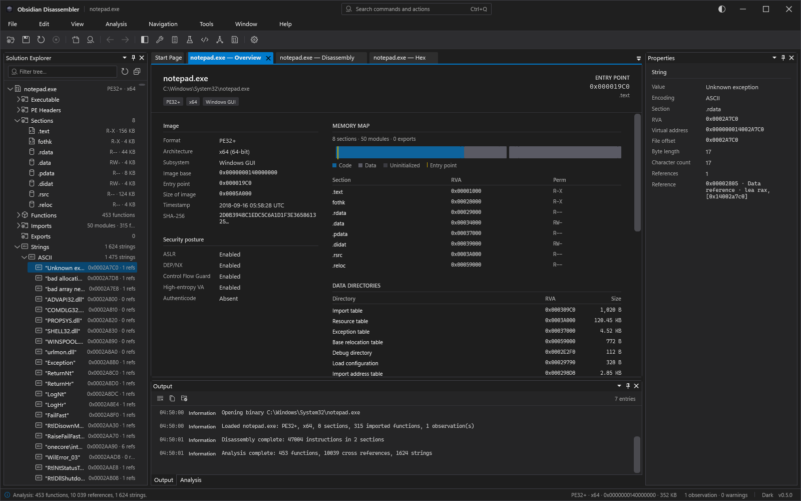 |

| Cross references | Instruction patching |
| --- | --- |
| 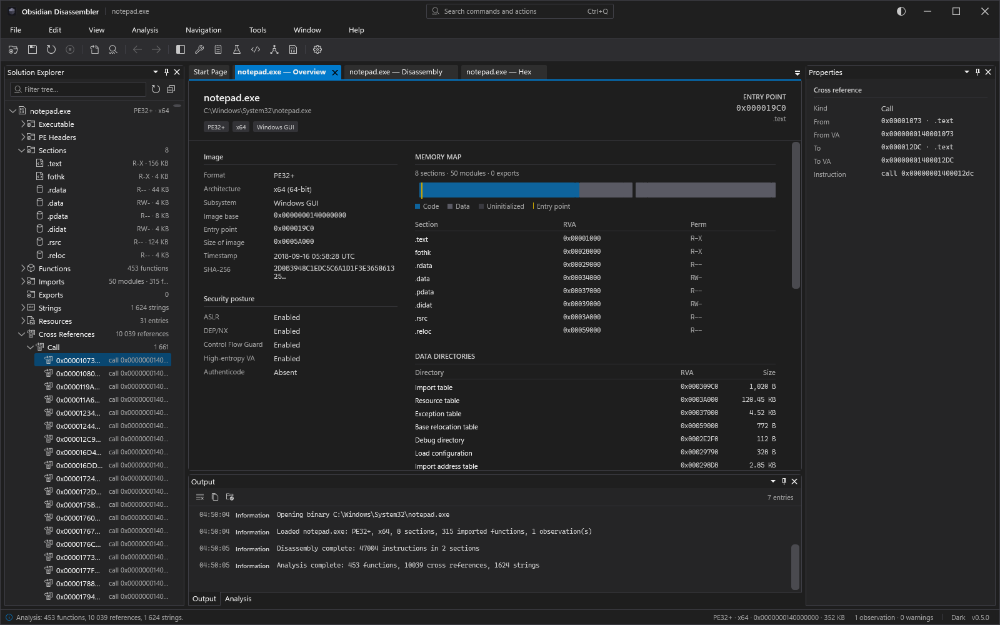 | 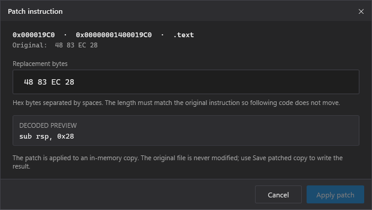 |

## Downloads

Every release contains two Windows x64 builds:

| Build | Requires .NET 10 | Recommended for |
| --- | --- | --- |
| `Obsidian-Disassembler-0.5.0-win-x64-standalone.zip` | No — the .NET runtime is bundled | Most users, clean machines, portable use |
| `Obsidian-Disassembler-0.5.0-win-x64-framework-dependent.zip` | Yes — [.NET 10 Desktop Runtime](https://dotnet.microsoft.com/download/dotnet/10.0) | Smaller download when the runtime is already installed |

1. Download the ZIP from [Releases](https://github.com/Stanfi1/OBSIDIAN-DISASSEMBLER/releases/latest).
2. Extract it to a writable folder.
3. Run `Obsidian.exe`.

No installer is required and no registry entries are created.

## Getting started

1. Open a PE32/PE32+ file with **File → Open Binary** or `Ctrl+O`.
2. Wait for disassembly and analysis to finish; the status bar reports progress.
3. Explore **Functions**, **Strings**, and **Cross References** in the Solution Explorer.
4. Open the **Analysis Browser** for searchable, virtualized result tables.
5. Click a function to open its control-flow graph; use **Open call graph** for its call neighborhood.
6. Create a project with **File → New Project** to persist labels, comments, bookmarks, and patches.

The original binary is never modified. Patching is an in-memory overlay; use **Save Patched Copy** when you want a patched file on disk.

## Keyboard shortcuts

| Shortcut | Action |
| --- | --- |
| `Ctrl+O` | Open binary |
| `Ctrl+Shift+N` | New project |
| `Ctrl+Shift+O` | Open project |
| `Ctrl+S` | Save project |
| `Ctrl+Shift+S` | Save project as |
| `Ctrl+R` / `F5` | Reload and analyze |
| `Ctrl+W` | Close binary |
| `Ctrl+Q` | Command palette |
| `Ctrl+G` | Go to address |
| `Ctrl+D` | Disassembly |
| `Ctrl+Shift+A` | Analysis browser |
| `Ctrl+Shift+C` | Call graph for the selected function |
| `Ctrl+Shift+G` | Control-flow graph |
| `Ctrl+H` | Hex editor |
| `Ctrl+E` | Patch selected instruction |
| `Ctrl+Shift+Z` | Undo patch |
| `Ctrl+Shift+Y` | Redo patch |
| `Ctrl+Shift+E` | Save patched copy |
| `Alt+Left` / `Alt+Right` | Navigate back / forward |
| `Ctrl+,` | Settings |

## Architecture

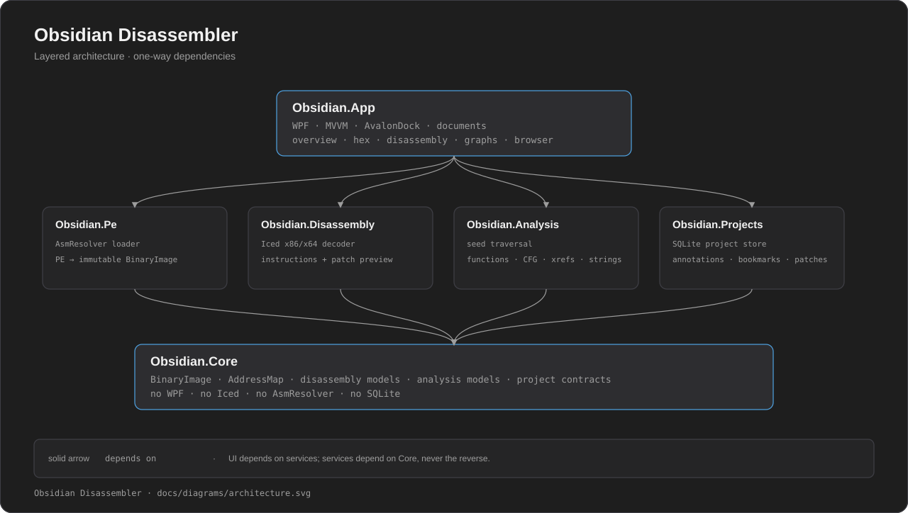

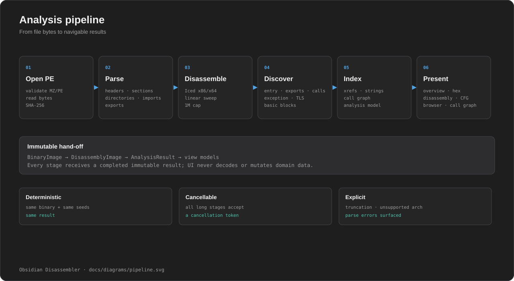

The analysis pipeline is deliberately one-way: the loader produces an immutable `BinaryImage`; the disassembler consumes it; analysis consumes the completed disassembly; the UI only renders immutable results. See [docs/ARCHITECTURE.md](docs/ARCHITECTURE.md) for the full design, data flow, and project/patch lifecycle.

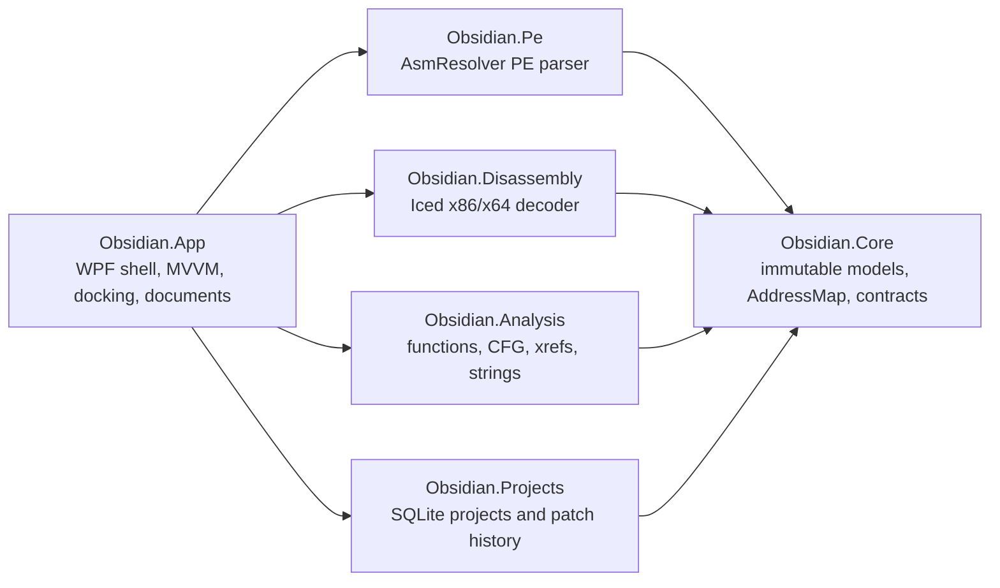

## Project files

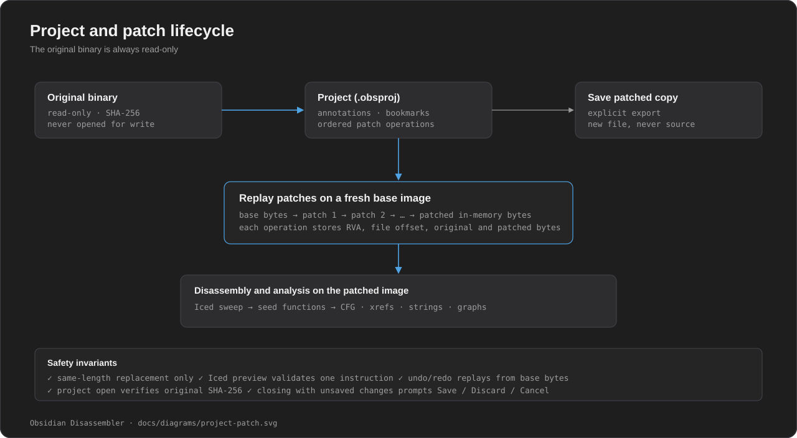

An `.obsproj` file is a portable SQLite database:

- Project metadata and original binary SHA-256
- Function labels, comments, and address annotations
- Bookmarks
- Ordered patch operations (RVA, file offset, original bytes, patched bytes)

Opening a project verifies the original binary and replays patch operations in order. The original binary stays untouched.

## Build from source

Requirements:

- Windows 10/11 x64
- .NET 10 SDK
- Windows Desktop workload

```text
dotnet restore Obsidian.sln
dotnet build Obsidian.sln -c Release
dotnet test Obsidian.sln -c Release
```

Framework-dependent publish:

```text
dotnet publish src\Obsidian.App\Obsidian.App.csproj -c Release -r win-x64 --self-contained false -o artifacts\publish\win-x64
```

Self-contained publish (no .NET runtime required on the target machine):

```text
dotnet publish src\Obsidian.App\Obsidian.App.csproj -c Release -r win-x64 --self-contained true -o artifacts\publish\win-x64-standalone
```

## Testing

- **69 unit tests** covering the address model, PE parsing, disassembly, analysis, SQLite projects, schema migration, and image patching.
- **55 UI smoke checks** covering project lifecycle, patch persistence and replay, analysis browser, call graph, CFG navigation, hex search, and document lifecycle.
- Release builds are expected to compile with zero warnings.

## Scope and constraints

Obsidian Disassembler is a static PE analysis tool:

- Native x86/x64 PE images; other architectures are rejected with a clear message.
- Linear disassembly with seed-based function discovery, not signature-based type analysis.
- Strings are collected from non-executable, file-backed sections.
- Cross references cover direct calls/jumps and RIP-relative data references.
- Instruction patching replaces an existing instruction with the same number of bytes and requires a valid single-instruction decode.
- Hex editing of arbitrary bytes is not part of the patching workflow.
- CFG and call graph views are read-only.
- Projects do not persist docking layout or open documents.
- Binaries are never executed.

## License

MIT © 2026 Stanfi1. See [LICENSE](LICENSE).

Third-party dependencies and their licenses are listed in [THIRD-PARTY-NOTICES.md](THIRD-PARTY-NOTICES.md).

## Contributing

Issues and pull requests are welcome. Please keep changes focused, add tests for behavior changes, and run `dotnet test Obsidian.sln -c Release` before opening a pull request.
