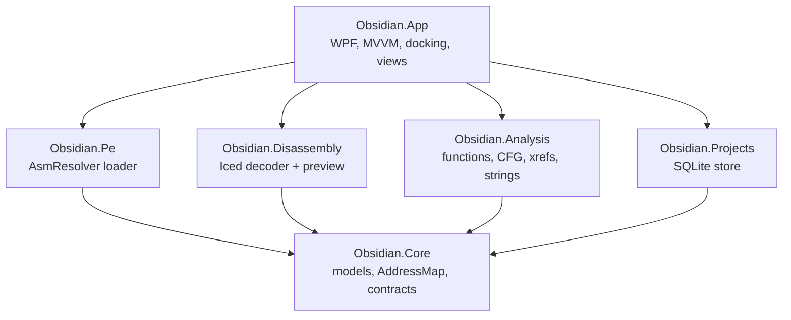
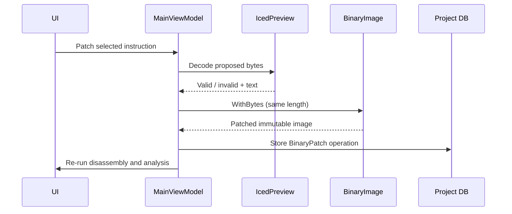

# Architecture

Obsidian Disassembler is a .NET 10 Windows desktop application for static analysis of native PE32/PE32+ binaries. The architecture keeps parsing, decoding, analysis, persistence, and presentation in separate projects with one-way dependencies.

## Goals

- Inspect PE structure without placeholder or fabricated values.
- Provide a fast, virtualized hex view and x86/x64 disassembly view.
- Discover functions and basic blocks from explicit seeds.
- Persist projects, annotations, bookmarks, and patch operations.
- Patch instructions safely without modifying the source binary.
- Keep the core model testable and independent of WPF.

## Layered design



Dependency rules:

- **Core** has no WPF, AsmResolver, Iced, SQLite, or Serilog references.
- **Pe** depends on Core and AsmResolver; it does not contain UI.
- **Disassembly** depends on Core and Iced; it does not contain UI.
- **Analysis** depends only on Core and consumes an immutable `DisassemblyImage`.
- **Projects** depends on Core and Microsoft.Data.Sqlite.
- **App** orchestrates services and renders immutable results. It does not parse PE or decode instructions directly.

## Repository layout

```text
src/
  Obsidian.Core/          domain models, AddressMap, formatting, contracts
  Obsidian.Pe/            AsmResolver loader and PE directory parsers
  Obsidian.Disassembly/   Iced x86/x64 linear disassembly and patch preview
  Obsidian.Analysis/      function discovery, CFG, xrefs, strings, call graph
  Obsidian.Projects/      SQLite project store and schema migrations
  Obsidian.App/           WPF shell, MVVM, views, dialogs, capture harness
tests/
  Obsidian.Core.Tests/
  Obsidian.Pe.Tests/
  Obsidian.Disassembly.Tests/
  Obsidian.Analysis.Tests/
  Obsidian.Projects.Tests/
docs/
  ARCHITECTURE.md, DESIGN.md, RESEARCH.md, screenshots/, diagrams/, media/
```

## Domain model

| Type | Purpose |
| --- | --- |
| `BinaryImage` | Immutable parsed image: bytes, SHA-256, headers, sections, directories, imports, exports, resources, findings, `AddressMap` |
| `AddressMap` | Lossless RVA ↔ VA ↔ file offset conversions with section boundaries |
| `DisassembledInstruction` | RVA/VA/offset, raw bytes, mnemonic, operands, flow, branch/data targets |
| `DisassemblyImage` | Immutable linear-sweep result with instruction lookup and truncation state |
| `DiscoveredFunction` | Seed-based function metadata and source reasons |
| `FunctionAnalysis` | Reachable instructions, basic blocks, CFG edges, complexity |
| `CrossReference` | Call, jump, conditional jump, or data reference |
| `StringLiteral` | ASCII/UTF-16LE candidate with file offset, section, and references |
| `AnalysisResult` | Immutable functions, strings, xrefs, call graph, diagnostics |
| `ProjectMetadata` | Name, binary path, original SHA-256, timestamps |
| `AddressAnnotation` | User label and comment for an RVA |
| `ProjectBookmark` | Named bookmark with optional note |
| `BinaryPatch` | Persisted same-length patch operation |

## PE loading

`PeImageLoader` performs the following:

1. Validate path, existence, file size, and the 2 GB in-memory limit.
2. Read bytes asynchronously with cancellation.
3. Validate `MZ`, `e_lfanew`, and `PE\0\0`.
4. Compute SHA-256 and parse with AsmResolver.
5. Project sections, headers, data directories, imports, exports, CLR metadata, and `AddressMap`.
6. Parse resources, relocations, TLS, exceptions, debug entries, and load configuration locally; a single directory failure produces a finding instead of aborting the load.
7. Run structural checks (W+X, ASLR, DEP, checksum, TLS, certificate, image size, entry point, overlapping sections, unusual section names).
8. Return an immutable `BinaryImage`.

Large-file parsing and hash computation run off the UI thread. Progress is marshalled through `IProgress<LoadProgress>`.

## Disassembly

- Only executable, file-backed sections are swept.
- `Iced` is used in x86/x64 mode; other architectures are rejected with a message.
- Branch targets are exposed only when they land in executable code.
- Invalid/truncated bytes are shown as `db 0xNN`, never as a fabricated instruction.
- The sweep is capped at 1,000,000 instructions and reports truncation explicitly.
- `IcedPreview` decodes exactly one proposed patch instruction for validation.
- Disassembly runs asynchronously with progress and cancellation.

## Analysis

The analysis engine consumes the completed disassembly and runs on a background task.

### Function discovery

Seeds are:

1. Entry point
2. Non-forwarded exports
3. Direct call targets
4. Exception runtime functions
5. TLS callbacks

Traversal follows fall-through and branch targets, but not call targets. It stops at another known function start. This prevents adjacent functions from being merged while keeping the analysis deterministic.

### Basic blocks and CFG

- Leaders are function entry, branch targets, and the instruction after a branch.
- Successors are resolved by block start RVA; predecessors are derived.
- Cyclomatic complexity is `edges - blocks + 2`.
- Calls are cross references, not CFG edges.

### Cross references and strings

- Direct calls, jumps, conditional jumps, and RIP-relative memory operands are indexed.
- ASCII and UTF-16LE candidates are collected from non-executable, file-backed sections.
- Strings are capped at 50,000 candidates and 512 characters; scanning is capped at 256 MB.

### Call graph

`AnalysisResult` derives callers/callees from direct call xrefs. The UI presents a focused call neighborhood for the selected function and re-centers when a node is clicked.

## Projects and patching

### SQLite project

The project database uses schema version 2:

- `Project` — metadata and original binary hash
- `Annotation` — labels/comments by RVA
- `Bookmark` — named addresses
- `Patch` — ordered same-length patch operations
- `SchemaInfo` — schema version

Opening a project verifies the original binary, then applies patches in order and runs analysis on the patched in-memory image. The original file is never modified.

### Patch lifecycle



Patch rules:

- The replacement must have the same length as the original instruction.
- The replacement must decode as exactly one valid instruction.
- The original image is preserved as the base for undo/redo and project replay.
- `Save Patched Copy` writes a separate file.

## UI architecture

- `MainViewModel` owns the workspace: image, overview, disassembly, analysis, browser, graphs, hex, explorer, properties, output, status, navigation, project, and patch state.
- `MainWindow` owns AvalonDock chrome and document lifecycle.
- `FunctionGraphView` renders the CFG with a custom Canvas and geometry; pan/zoom/fit are view-only.
- `CallGraphView` renders the call neighborhood with a deterministic layout.
- `AnalysisBrowserView` uses virtualized `ListBox` controls over `ListCollectionView`.
- `PatchInstructionWindow` validates and previews patch bytes.
- `SolutionExplorerViewModel` owns the tree; annotations and bookmarks are applied through observable node titles/details.
- All modal interaction is routed through `IDialogService`.

## Persistence and undo

- Project annotations, bookmarks, and patches are held in memory and written transactionally.
- `SaveChangesWindow` protects unsaved annotations/patch changes on close or project switch.
- Patch operations are the undo/redo unit; rebuilding always starts from the original bytes.
- The UI marks patch state in the title bar and status bar.

## Performance

- Hex rows are lazy and cached by an `IList` implementation.
- Disassembly and analysis run off the UI thread.
- The analysis browser virtualizes rows and filters only the already-loaded result set.
- Explorer strings/xrefs are grouped and explicitly labelled; the browser is the preferred view for large result sets.
- All source bytes remain in memory; the current loader is intended for typical desktop binaries.

## Testing

- 69 unit tests across Core, PE, disassembly, analysis, and projects.
- 55 UI smoke checks covering docking, menus, project lifecycle, patch persistence/replay, graphs, browser filtering, hex search, and document lifecycle.
- `--capture`/`--dialog` render WPF screens to PNG for visual regression.

## Architectural decisions

| ID | Decision | Reason | Consequence |
| --- | --- | --- | --- |
| ADR-001 | .NET 10 LTS + WPF | Modern long-term runtime and native Windows desktop UI. | Windows 10/11 x64 target. |
| ADR-002 | AsmResolver 6.1 split packages | Mature managed PE parser with rich directory APIs. | Reference `AsmResolver.PE` and `AsmResolver.PE.File` directly. |
| ADR-003 | AvalonDock 5.0.2 + VS theme | Native docking with floating/resize support. | Minor theme overrides for caption grips. |
| ADR-004 | Custom design system | VS-like dense IDE rather than a web dashboard. | All XAML components are project-owned. |
| ADR-005 | UI-independent Core | Testability and format independence. | Strict one-way project dependencies. |
| ADR-006 | Custom `AddressMap` | PE address math must be independently testable. | Small duplication around AsmResolver boundaries. |
| ADR-007 | Whole-file loading | Simplicity for typical desktop binaries. | 2 GB cap; no memory mapping. |
| ADR-008 | Serilog UI sink | One log source for file and Output panel. | Dispatcher marshalling and a 3,000-entry cap. |
| ADR-009 | WPF screenshot harness | HTML tooling cannot inspect native WPF. | `--capture` and `--dialog` are part of the app. |
| ADR-010 | Custom dialogs | Consistent dark/light theme and layout. | `IDialogService` is the modal boundary. |
| ADR-011 | Lazy hex rows | Avoid millions of row objects for large files. | Rows are created on demand and cached. |
| ADR-012 | Manual debug-directory parser | Stable CodeView/PDB paths independent of AsmResolver version. | 28-byte entry parser with tests. |
| ADR-013 | Flat resource model | UI should not walk AsmResolver objects. | `PeResourceEntry` is immutable and flat. |
| ADR-014 | Iced 1.22 | Managed x86/x64 decoder with encoder support. | x86/x64 only. |
| ADR-015 | Linear sweep + seed traversal | Deterministic foundation for function discovery. | Embedded data can look like code; UI labels the mode. |
| ADR-016 | Custom virtualized disassembly grid | Tens of thousands of rows need stable virtualization. | No text editor for disassembly. |
| ADR-017 | Read-only original | Analysis and patching must never corrupt the source. | Patch output is always a copy. |
| ADR-018 | Analysis project separate from UI | Testable analysis without WPF/Iced. | Analysis consumes completed disassembly. |
| ADR-019 | Seed-based functions | Deterministic and practical without full type analysis. | No indirect targets or signature reconstruction. |
| ADR-020 | Strings from data sections only | Executable bytes create too many false candidates. | `.text` literals are not listed as strings. |
| ADR-021 | Custom BFS graph layouts | Deterministic, dependency-free, readable. | Large graphs use fit/scroll and explicit caps. |
| ADR-022 | RIP-relative data xrefs | Reliable from Iced without extra decoding. | x86 absolute data refs are not indexed. |
| ADR-023 | SQLite project store | Durable projects with a portable single file. | Schema migrations are versioned and tested. |
| ADR-024 | Transactional project snapshots | Simple consistency guarantee. | Entire annotation/patch snapshot is rewritten. |
| ADR-025 | Same-length byte patches | No PE layout shift; preview can validate decode. | Only existing instruction bytes can change. |
| ADR-026 | Patch overlay + persisted operations | Safe undo and deterministic project replay. | Original binary remains read-only. |
| ADR-027 | Virtualized analysis browser | Thousands of functions/xrefs need searchable lists. | `ListCollectionView` + recycled rows. |
